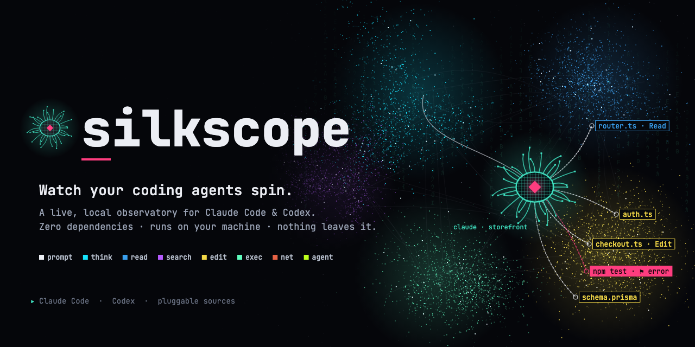
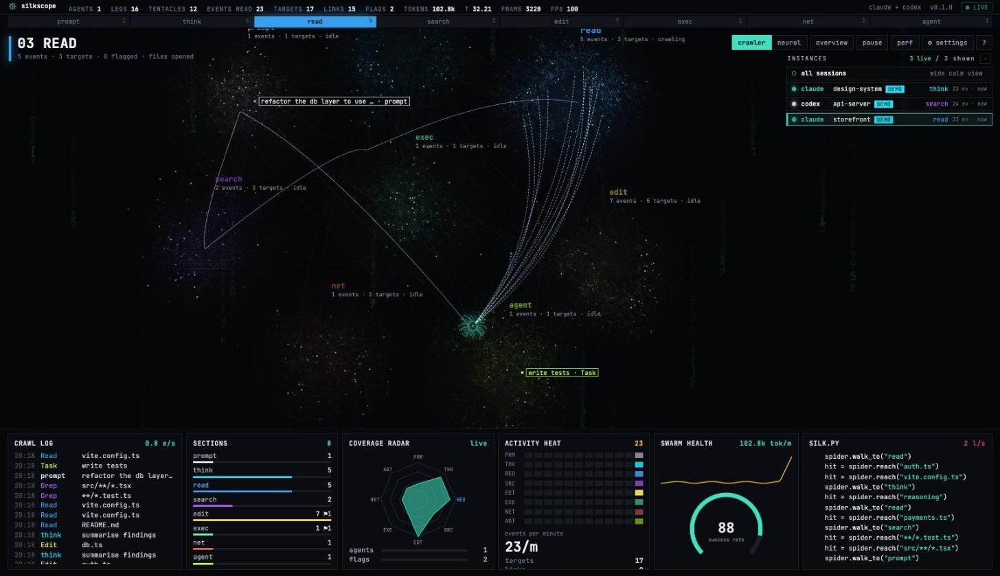
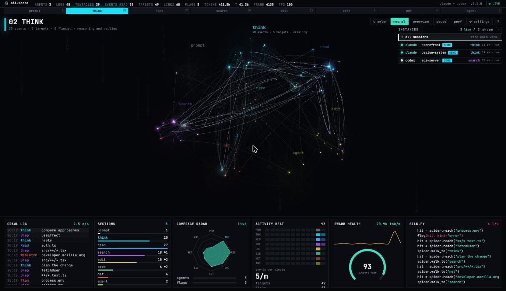

<p align="center">
  
</p>

<p align="center">
  <a href="https://github.com/janhorecny/silkscope/actions/workflows/ci.yml"></a>
  
  
  
  <a href="LICENSE"></a>
</p>

**Silkscope** is a live, local observatory for **Claude Code** and **Codex**. Every agent session
becomes a crawler that walks a nebula of your codebase. It throws tentacles at the files it reads,
the commands it runs and the URLs it fetches. Failed tool calls light up as flags. Underneath, a HUD
keeps score.

It reads the transcripts your agents already write to disk, so there is nothing to configure and
nothing to install into your agent. It runs on `127.0.0.1` and has zero dependencies.

<p align="center">
  
</p>

## Quick start

```bash
git clone https://github.com/janhorecny/silkscope && cd silkscope
npm start            # opens http://127.0.0.1:7777 and starts tailing your agents
```

Silkscope opens on an intro screen. The crawler spins a web while it connects and indexes your
transcripts, and the web is finished when loading is done. Press **START** to watch the last few
hours replay into the map. You can skip the intro in settings or with `?intro=0`.

There is nothing to `npm install`. Node 18 or newer is all you need. No agents running yet? Try
`npm run demo` for three synthetic sessions, clearly marked `DEMO`. To get a global `silkscope`
command, run `npm install -g .` inside the clone.

## How it works

1. **Read.** Claude Code writes every step to `~/.claude/projects/**/*.jsonl` and Codex to
   `~/.codex/sessions/**/rollout-*.jsonl`. Silkscope tails those files as they grow.
2. **Normalise.** A small adapter per agent turns each line into one event shape: a session, a
   section and a target, for example *edit · `checkout.ts`* or *exec · `npm test`*. A tool result
   then resolves the pending call as ok, or flags it.
3. **Render.** The server streams events over Server-Sent Events. The browser draws them with
   Canvas2D, eight nebulae for eight kinds of work, one crawler per session, at your display's
   refresh rate.

More in [docs/ARCHITECTURE.md](docs/ARCHITECTURE.md).

## What you are looking at

| you see | it means |
|-|-|
| eight clouds | sections: **prompt** · **think** · **read** · **search** · **edit** · **exec** · **net** · **agent** |
| crawler, teal shell, pink core | a Claude Code session |
| crawler, white shell, cyan core | a Codex session |
| fan of long tentacles | the session is about to move to that section |
| tentacle + tag | one tool call touching its target |
| solid pink tag `⚑ error` | that tool call failed (non-zero exit or `is_error`) |
| blinking yellow block | the tool call is still running |
| near-white line behind a crawler | its silk: where it walked in the last 45 s |
| strands between clouds | how often sessions move between those sections |

## Two views

**Crawler** is the look of the reference recording. The camera follows a session closely, cuts
when it changes section, dollies in while it works, and only labels what a tentacle touches.

**Neural** is fully abstract. Each target is a neuron and each move from one target to the next is
a synapse that thickens with use. Every tool call fires, and the signal cascades two hops along
the paths your agent actually took. There is no text until you hover.

<p align="center">
  
</p>

Press `V` to switch views.

## Watch one session or all of them

The **instances** list (top right) shows every Claude Code and Codex session with its project,
current section, event count and last activity. Click one to rebuild the map and every panel for
that session alone, with the camera locked on it. **all sessions** gives a calm wide shot of
everything. `Tab` cycles through sessions, `A` goes back to all.

## Controls

| | |
|-|-|
| **crawler · neural** | view switch (`V`) |
| **overview** | fit the whole map (`0`, double-click) |
| **pause** | freeze motion behind an overlay with a play button; events keep recording and are counted (`space`) |
| **perf** | frame timing, browser and server memory, live object counts (`P`) |
| **⚙ settings** | camera, labels, agents, instance window, render quality, reduced motion, matrix rain, intro screen, demo feed (`S`) |
| drag · wheel | pan · zoom around the cursor |
| click | a cloud to focus it · a tag or neuron to inspect every call on it · a crawler for its details |
| `1`–`8` · `L` · `M` · `D` · `?` | jump to section · labels · matrix rain · demo · help |

Every setting is explained in [docs/UI.md](docs/UI.md).

## Command line

```
silkscope [options]

  --port <n>          port to listen on (default 7777, auto-increments if busy)
  --host <addr>       bind address (default 127.0.0.1)
  --no-open           do not open the browser
  --demo              start with the synthetic demo feed
  --hours <n>         hours of history to replay on load (default 8)
  --sources <ids>     comma-separated: claude,codex (default: every one whose dir exists)
  --claude-dir <dir>  Claude Code transcripts (default ~/.claude/projects, honours CLAUDE_CONFIG_DIR)
  --codex-dir <dir>   Codex transcripts (default ~/.codex/sessions, honours CODEX_HOME)
```

## Privacy

Transcripts can contain code, prompts and secrets, so Silkscope keeps everything on your machine.
It only reads files and never writes them. The server binds to localhost and sends no telemetry.
The page loads one web font from Google Fonts. Details are in [SECURITY.md](SECURITY.md).

## Performance

Measured in Chrome on a 1600×1100 window with real and demo sessions, the app holds the display's
refresh rate in both views. That was 100 fps with a p95 frame of about 11 ms and no frame over
20 ms. A full frame costs about 1 ms of JavaScript, and the browser heap stays near 27 MB. The
server starts in about 0.2 s over roughly 3,900 transcripts, uses about 108 MB RSS and idles at
about 1 % CPU.

If the frame rate drops, quality adapts on its own. Press `P` to watch the numbers live. See
[docs/PERFORMANCE.md](docs/PERFORMANCE.md) for how it is done and how to measure it yourself.

## Supported agents

| agent | transcripts | status |
|-|-|-|
| Claude Code | `~/.claude/projects/**/*.jsonl` | verified against live sessions |
| Codex CLI | `~/.codex/sessions/YYYY/MM/DD/rollout-*.jsonl` | verified against the documented format and tests |

Adding another agent takes one adapter file in `server/sources/`. See
[docs/ADDING-A-SOURCE.md](docs/ADDING-A-SOURCE.md).

## Docs

- [Architecture](docs/ARCHITECTURE.md): data flow, modules, lifecycle
- [Events](docs/EVENTS.md): the event schema and the SSE protocol
- [Rendering](docs/RENDERING.md): layers, camera, crawler motion, neural cascade
- [UI](docs/UI.md): panels, settings, hotkeys
- [Performance](docs/PERFORMANCE.md): design and measurements
- [Research](docs/RESEARCH.md): frame-by-frame analysis of the recording that inspired the motion
- [Brand](brand/BRAND.md): name, mark, palette (colour-blind tested), type

## Contributing

Issues and pull requests are welcome. Start with [CONTRIBUTING.md](CONTRIBUTING.md). The project
deliberately has zero dependencies and no build step, and it should stay that way.

## Credits

The crawler's motion is modelled on a prompt-building screen recording credited to
**defileo** on X, which first showed a role, objective and context as nebulae and a crawler walking
between them. Silkscope is an independent implementation that applies the idea to live agent
telemetry.

## License

[MIT](LICENSE) © 2026 Jan Horecny
