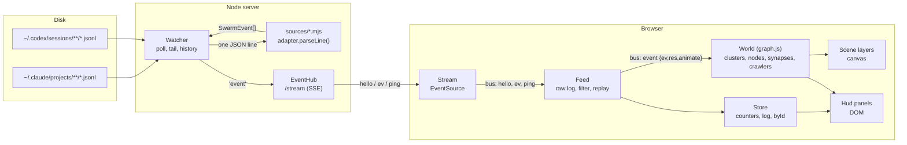

# Architecture

Silkscope is two small programs joined by one HTTP stream:

- a **Node server** (`server/`, started by `bin/silkscope.mjs`) that tails agent transcript files,
  normalises every line into one event shape and pushes events to browsers over Server-Sent Events;
- a **browser client** (`public/`) that folds those events into a world model and draws it on a
  Canvas2D stage with a DOM HUD around it.

No runtime dependencies, no build step, plain ES modules on both sides. The motion design was
derived from a reference recording; that analysis lives in [RESEARCH.md](RESEARCH.md).

## Data flow

1. **Transcript file.** Agents (Claude Code, Codex, pi, Gemini CLI, Droid) append JSONL lines to files under their home
   directories. Silkscope only reads them.
   opencode keeps a SQLite database instead; its adapter is a database source the watcher polls
   (see [ADDING-A-SOURCE.md](ADDING-A-SOURCE.md#4b-database-sources)).
2. **Adapter** (`server/sources/<id>.mjs`). Turns one parsed JSON line into 0..n normalised events
   (see [EVENTS.md](EVENTS.md)). Per-file parse state lives in a `SourceContext`.
3. **Watcher** (`server/watcher.mjs`). Discovers transcript files, polls them for growth, reads the
   new bytes, splits complete lines, calls the adapter, emits `'event'` and keeps a bounded
   `history` array.
4. **EventHub** (`server/hub.mjs`). On `GET /stream` sends one `hello` (with the history), then
   broadcasts each live `ev` and a `ping` with server stats every 2 s.
5. **Stream** (`public/js/core/stream.js`). `EventSource` wrapper; re-emits frames on the bus.
6. **Feed** (`public/js/core/feed.js`). Keeps every raw event, the per-session index for the
   instance picker, the watched-instance and agent filters, the history replay and the demo feed.
   Events that pass the filter go to `Store.ingest()` and, if they mean something, out on the bus as
   `event`.
7. **Store** (`public/js/core/store.js`) aggregates numbers for the HUD; **World**
   (`public/js/render/graph.js`) turns events into nodes, synapses, signals and crawler work queues.
8. **Layers** (`public/js/render/layers/*`) draw the World every frame; **panels**
   (`public/js/ui/panels/*`) read Store, Scene and Feed at 4 Hz (some every frame).

Everything in the client talks through one synchronous `Bus` (`public/js/core/bus.js`); the event
list is documented at the top of that file.

## Module map

### Server

| File | Role |
|-|-|
| `bin/silkscope.mjs` | CLI: parses flags, calls `startServer()`, prints the banner, opens the browser. |
| `server/server.mjs` | `startServer(opts)`: builds Watcher + EventHub + static handler, routes `/stream`, binds with port auto-increment; `resolveSources()` picks adapters and dirs; `serverStats()` is the `ping` payload. |
| `server/watcher.mjs` | `Watcher`: file discovery with a directory-mtime cache, hot/cold polling, start-up backfill, tailing with partial-line buffering, `history`. |
| `server/hub.mjs` | `EventHub`: SSE fan-out with per-client backpressure. |
| `server/static.mjs` | `staticHandler(root)`: serves `public/` with `Cache-Control: no-store` and a path-traversal guard. |
| `server/events.mjs` | `CATEGORIES`, `INTERNAL`, JSDoc types `SwarmEvent`, `SourceContext`, `SourceAdapter`, and `baseContext()`. |
| `server/sources/index.mjs` | `ADAPTERS` registry and `adapterById()`. |
| `server/sources/claude.mjs` | Claude Code adapter. |
| `server/sources/codex.mjs` | Codex CLI adapter. |
| `server/sources/shell.mjs` | `clip`, `base`, `unwrapShell`, `classifyShell` shared by adapters. |

### Client

| File | Role |
|-|-|
| `public/index.html` | Static shell: top bar, tabs, canvas, toolbar, settings/perf/help/inspector containers, `#hud`. |
| `public/js/main.js` | Bootstrap: creates Bus, Store, Settings, Scene, Feed, Hud and panels; wires stream events; runs the rAF loop; exposes `window.__swarm`. |
| `core/bus.js` | Synchronous pub/sub; the only channel between modules. |
| `core/stream.js` | `EventSource` client with exponential reconnect. |
| `core/feed.js` | Raw event log, instance index, filters, rebuild, replay, demo switch. |
| `core/store.js` | HUD aggregates: per-category counts, sessions, call index (`byId`), log, minute buckets, links, health. |
| `core/settings.js` | Settings schema, persistence and the settings panel markup. |
| `core/config.js` | Brand colours, the 8 categories (colour, code, map position), agent styles. |
| `core/demo.js` | Synthetic event generator (2 Claude + 1 Codex sessions). |
| `core/util.js` | Math, easing, noise, PRNG, colour caches (`rgbaQ`), formatting. |
| `render/scene.js` | Scene orchestrator: layers, input, hit-testing, adaptive quality. |
| `render/camera.js` | Camera modes, flights, dolly, pan/zoom. |
| `render/graph.js` | `World`: clusters, synapses, signals, bursts, pulses, crawler pacing. |
| `render/nebula.js` | `Cluster`: point cloud, pre-rendered sprites, target nodes, recency list. |
| `render/spider.js` | `Spider`: crawler motion, tentacles, silk, drawing. |
| `render/layers/*.js` | One file per draw pass (background, web, clusters, synapses, crawlers, labels + hover). |
| `ui/hud.js` | Panel registry; 4 Hz `update(state)` and per-frame `frame()`. |
| `ui/panel.js` | `Panel` base class and change-only DOM helpers. |
| `ui/panels/*.js` | One file per widget (see [UI.md](UI.md)). |

## Lifecycle

### 1. Start-up backfill (server)

`Watcher.start()`:

1. Walks every source directory (max depth 6, skipping dot-dirs, `node_modules` and the adapter's
   `skipDir`) and stats every transcript.
2. Sorts files newest first. For each file modified within `backfillHours` (default 8, CLI
   `--hours`), and only while fewer than 80 files have been read and fewer than
   `ceil(backfillMax × 1.3)` events collected (`backfillMax` = 900):
   - parses the first `primeLines` lines to learn session/project/model (events discarded,
     `ctx.seen` cleared);
   - reads only the last 768 KB of the file (skipping the first, probably partial, line).
3. Every other file is tracked at its current size, so only future appends are read.
4. Backfilled events are sorted by `ts` and the newest 900 kept as `watcher.history`.
5. Starts two `setTimeout` chains: `#tick` every 700 ms (read appends) and `#scan` every 4 s
   (discover new files).

Start-up cost therefore does not grow with the number of old sessions; see
[PERFORMANCE.md](PERFORMANCE.md).

### 2. Page load and history replay (client)

1. `main.js` constructs everything, applies saved settings by emitting one `setting` per key, starts
   the render loop and opens `/stream`.
2. The server answers with `hello { sources, files, history, demo }`.
3. On the **first** hello, `Feed.replay(history)`:
   - appends every event to `feed.raw` and the instance index;
   - restores the watched instance from `localStorage['swarm.instance']` if that session exists;
   - folds all but the last 60 matching events into Store/World **silently** (`animate = false`);
   - emits `rebuild` (crawlers are parked where each recent session last was) and `watch`;
   - replays the last 60 events **animated**, one every 90 ms, with `world.speed = 2.2`, bracketed by
     `replay {count}` / `replay {done: true}`.
4. If the server was started with `--demo` or the URL has `?demo`, the demo feed is switched on;
   if there is no history and no demo, `idle` is emitted and the banner says so.
5. Reconnects send a fresh hello, but its history is ignored (`first = false`) so the live picture is
   kept. Events emitted while disconnected are not re-sent.

### 3. Live events

`Watcher.#tick` stats tracked files (hot ones every tick, cold ones every 10th tick), reads new
bytes, parses complete lines, pushes events to `history` and emits them. `EventHub` broadcasts each
as an `ev` frame. On the client, `Feed.ingest(ev, true)` stores it, and if it passes the filter
`Store.ingest()` returns a result (`action`, `result`, `tokens` or `null`); non-null results go out
as `event {ev, res, animate: true}`. `World.handle()` creates or updates the target node and
synapse and pushes the action onto the session's crawler queue, which `World.update()` drains at a
readable pace (see [RENDERING.md](RENDERING.md#crawler-pacing-queue)).

### 4. Instance filtering and rebuild

Two filters decide what reaches Store and World (`Feed.passes`): the watched session
(`feed.filter`, null = all) and the `agents` setting (`both`, `claude`, `codex`).

Changing either calls `Feed.rebuild()`:

1. `store.reset()` and bus `reset` (Scene resets the World and selection; panels with `reset()`
   clear their state).
2. Every event in `feed.raw` that passes is re-applied silently.
3. Bus `rebuild {sessions}`: the World parks a crawler for each session active in the last 30
   minutes (plus the watched one) and re-attaches up to 12 tentacles to its last-touched nodes.

`Feed.watch(id)` also stores the choice and emits `watch {id, session, announce: true}`, which
moves the camera into auto mode with a flight and shows the banner.

Because `feed.raw` keeps up to 8,000 events, switching instance is instant and needs no server
round trip.

## Where state lives

| State | Owner | Bound |
|-|-|-|
| Tracked files, offsets, partial lines, parse contexts | `Watcher.files` (server) | every transcript file found |
| Directory listing cache | `Watcher.dirs` (server) | one entry per directory |
| Replay history | `Watcher.history` (server) | trimmed to 900 when it exceeds 1,800 |
| Raw events | `Feed.raw` | 8,000, trimmed to the newest 7,200 |
| Instance index | `Feed.sessions` | one entry per session ever seen (not reset on rebuild) |
| Watched instance | `Feed.filter`, `localStorage['swarm.instance']` | |
| Counters, per-category sets, log, minute buckets | `Store` | log 60 rows, 90 minute buckets, `byId` 4,000 calls |
| Nodes per section | `Cluster.nodes` / `Cluster.recent` | 220 per section, coldest evicted |
| Synapses | `World.synapses` | 2,400; weakest stale tenth pruned |
| Neural signals / bursts | `World.signals` / `World.bursts` | ~500 / 600 |
| Crawlers | `World.spiders` | 8; idle ones fade after 20 min |
| Per-crawler queue, tentacles, silk | `Spider` | queue 40, tentacles 22 live, silk 700 points / 45 s |
| Camera | `Camera.cam` (shared by reference) | |
| User settings | `Settings.v`, `localStorage['swarm.settings']` | |
| Instance list collapsed | `localStorage['swarm.collapsed']` | |

Storage keys, console messages (`[swarm] …`) and the debug handle `window.__swarm` use the internal
name `swarm`, not `silkscope`.
